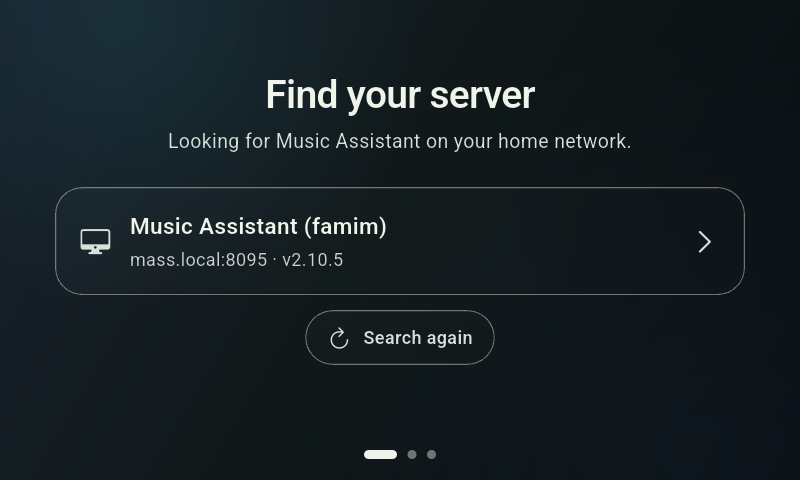
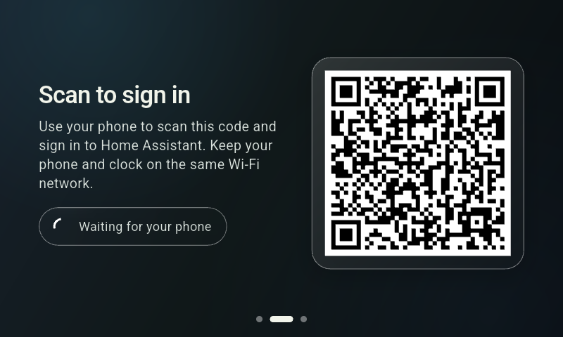
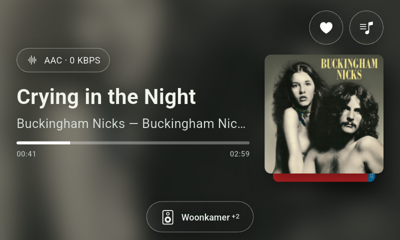
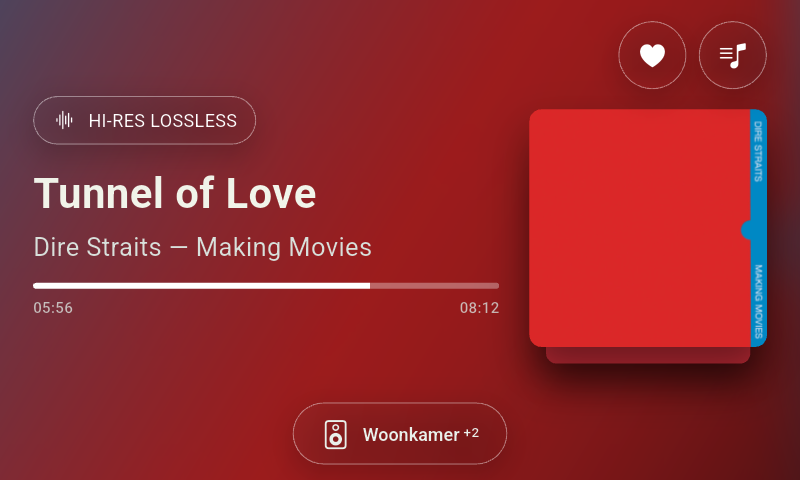
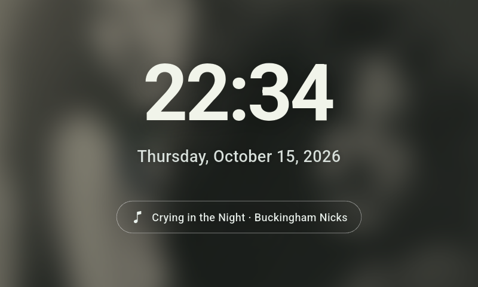
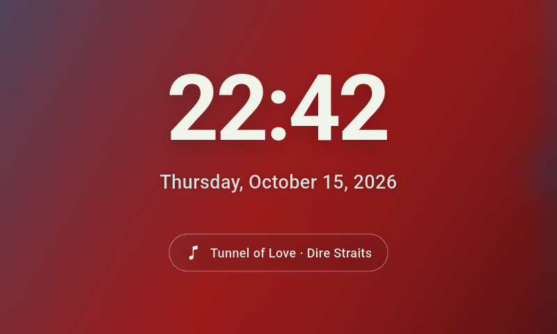
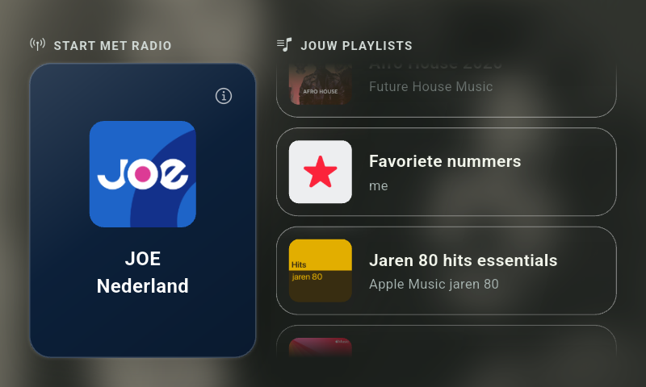
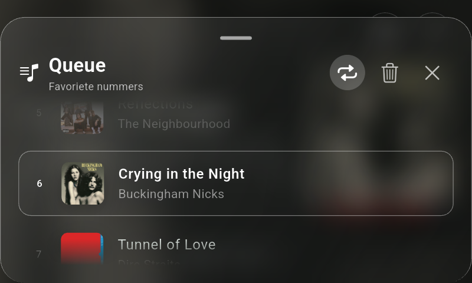

# Living Room Music Assistant

A dedicated Flutter client designed for Android smart displays (such as the Xiaomi Mi Smart Clock) to serve as an always-on living room controller for **Music Assistant**.

---

## Screenshots

| Onboarding / Auth | QR Authentication |
| :---: | :---: |
|  |  |

| Player View | Player view |
| :---: | :---: |
|  |  |

| Screensaver Clock View | Screensaver Clock View |
| :---: | :---: |
|  |  |

| Idle & Quick Select | Queue |
| :---: | :---: |
|  |  |
---

## Motivation

In our home, we love listening to radio and music throughout the day across various smart speakers. However, standard streaming via services like TuneIn and Chromecast repeatedly stopped mid-day due to buffering timeouts—requiring someone to unlock a phone, reconnect, and sit through ads just to get the music back on.

**Music Assistant** solved this problem by managing active, buffered streams directly on the server level for all household speakers. 

To make controlling music seamless for everyone at home, I repurposed a **Xiaomi Mi Smart Clock** (a cheap, sub-€50 device with a touchscreen, built-in speakers, physical hardware buttons, and a clean desktop housing). By flashing custom Android GSI onto the clock, I created a dedicated kiosk controller that stays on the counter to easily kick off radio streams, adjust volumes, or check what's currently playing.

### Modding the Mi Smart Clock
The clock was modded to run vanilla Android using the following community guides and tools:
* **Guide**: [Xiaomi Mi Smart Clock Development Guide (GSI) on XDA Forums](https://xdaforums.com/t/xiaomi-mi-smart-clock-development-guide-gsi.4629771/)
* **Flashing Tools**: [octathorp/x04g_tools](https://github.com/octathorp/x04g_tools)
* **MTK Client**: [bkerler/mtkclient](https://github.com/bkerler/mtkclient)

---

## Features

* **Guided Onboarding**: Simple first-time setup flow with automatic discovery.
* **QR-Code Authentication**: Authenticate with Music Assistant via Home Assistant OAuth by scanning a QR code.
* **Screensaver & Clock**: Displays an ambient screensaver/clock page when music is idle.
* **Idle Quick-Start Dashboard**: Instant 1-tap access to your favorite library radio station and playlists.
* **Full-Featured Player View**:
  * Rich animated backdrop matching current artwork color palettes.
  * Hardware volume control (supports physical volume buttons on the Mi Smart Clock and standard Android hardware keys).
  * Individual speaker and group volume management.
  * Track controls (Play/Pause, Skip Next/Previous).
  * Queue view: inspect queue items, jump directly to a track, or remove tracks.
  * Toggle autoplay mode.
* **Settings Page**: Switch target players and configure kiosk behavior.

---

## Prerequisites & Requirements

* **Music Assistant Server** running on your local network.
* **Home Assistant Server** running (used for QR-code authentication).
* Flutter SDK and Dart versions matching constraints in `pubspec.yaml`.

---

## Quick Start

```sh
# Fetch dependencies
flutter pub get

# Run on a connected device or emulator
flutter run
```

Note on Kiosk Mode: When deployed to Android, the app runs in immersive full-screen mode and prevents the screen from going to sleep. Server credentials and active sessions are stored securely on device storage.

## Hardware Compatibility

Xiaomi Mi Smart Clock (x04g): Primary target device. Physical volume keys and display dimensions are fully supported.

Other Devices: Should run on the Lenovo Smart Clock 2 or other Android-based smart displays / tablets running a custom GSI ROM (untested).

## API Compatibility & Architecture

Music Assistant Version: Based on the OpenAPI schema for Music Assistant 2.10.5.

Code Generation: The source and scoped schemas used to generate API models are located in api/. Refer to docs/API_CODE_GENERATION.md for generation workflows.

API Package Migration: The project is transitioning to a dedicated Dart package located in packages/music_assistant_api. It currently handles HTTP routes and generic WebSocket command dispatching (used for server info retrieval).

## Project Status & Disclaimer

[!NOTE]
This is a hobby project created for personal home automation needs and is vibe-coded in large parts. It is not intended for critical or production environments.

Performance on low-end hardware (like the Mi Smart Clock) is functional but still has room for optimization. Pull requests, optimizations, and feature contributions are very welcome!